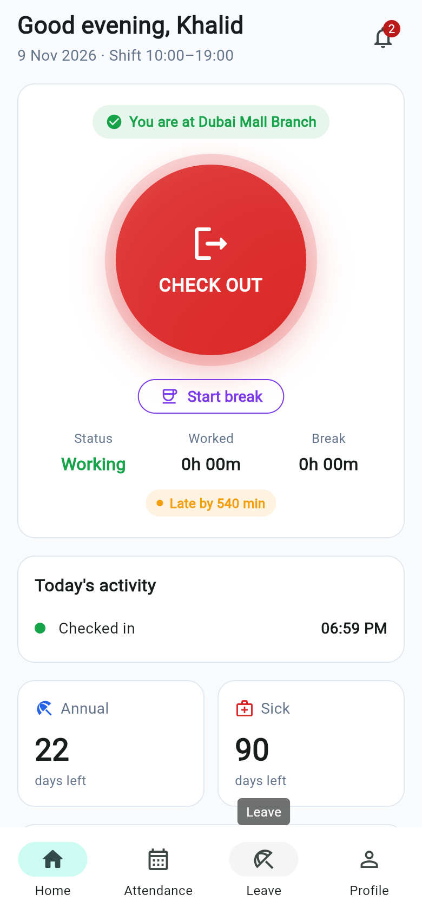
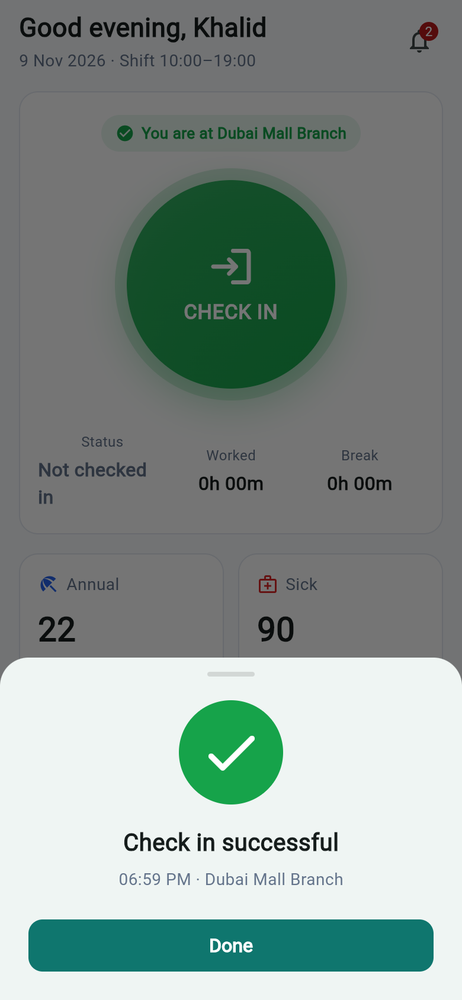
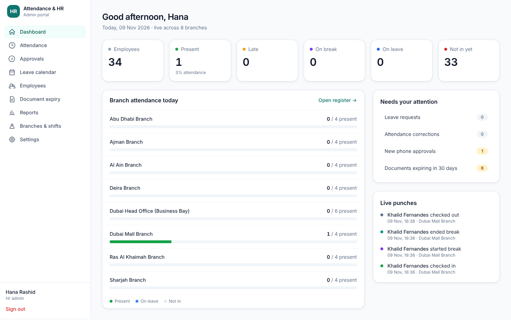

# Attendance & HR System (UAE)

This is a complete attendance and HR system for a company with **8 branches and about 100 employees** in the UAE.

| Part | Folder | Tech | Who uses it |
|---|---|---|---|
| Employee mobile app | `mobile-app/` | Flutter (Android + iOS) | All employees and branch managers |
| HR / admin web portal | `admin-portal/` | Next.js + Tailwind | HR, branch managers, owner |
| Backend API + database | `backend/` | NestJS + Prisma + PostgreSQL | Both apps |

| Mobile: home | Mobile: check-in | HR portal: dashboard |
|---|---|---|
|  |  |  |

More screenshots are in `docs/screenshots/`. The full specification is in [`docs/ATTENDANCE_HRMS_BLUEPRINT.md`](docs/ATTENDANCE_HRMS_BLUEPRINT.md).

---

## Features

### Mobile app (employees)
- **Check in, check out, start break and end break.** One big button shows only the action that is valid now.
- Every punch is verified by:
  - **Branch geofence (GPS)**, or a match with the branch Wi-Fi
  - **Selfie**
  - **Registered phone only.** The first phone is linked automatically; a new phone needs HR approval.
  - **Fake GPS and rooted / jailbroken phone detection**
  - **Server time only**, so changing the phone clock has no effect
- A live "You are at Dubai Mall Branch" indicator and a work/break timer
- **Attendance calendar** with colour-coded days, day details and **correction requests** for forgotten punches
- **Leave**: balance cards for each leave type, apply with dates, half day and a medical certificate photo, track status, cancel
- **Profile**: UAE documents with expiry countdown, job details, gratuity estimate, and editing of contact and emergency details
- **Team tab for managers**: who is in today, plus approve or reject leave
- Fingerprint / Face ID unlock, notifications, and a forced password change on first login

### HR web portal
- **Dashboard**: live attendance across all 8 branches, pending approvals, documents about to expire, and a live punch feed
- **Attendance register** by date and branch, with filters and HR manual correction (a reason is required and the change is audited)
- **Approvals**: leave (manager first, then HR), attendance corrections, and new phones
- **Leave calendar** showing team leave and UAE public holidays
- **Employees**: full UAE profile, a document vault for Emirates ID, passport, visa, labour card and insurance (with scans), monthly attendance with selfies, leave balances and adjustments, registered devices, and password reset
- **Document expiry report.** Reminders are sent automatically 90, 60, 30 and 7 days before expiry.
- **Reports**: monthly attendance (Excel/CSV) and **payroll input for WPS** (absent days, unpaid leave, overtime)
- **Branches & shifts**: geofence location and radius, Wi-Fi, shift times, grace minutes and weekly off days
- **Settings**: leave policy, UAE holidays, MFA (authenticator app) and the audit log

### UAE leave rules (all editable by HR)
| Leave | Default |
|---|---|
| Annual | 2 days/month after 6 months of service; 30 days/year after 1 year (accrued monthly) |
| Sick / medical | 90 days/year after probation: **15 full pay, 30 half pay, 45 unpaid** (worked out automatically); certificate required for more than 1 day |
| Maternity | 60 days (45 full + 15 half pay) |
| Parental | 5 working days |
| Bereavement, Hajj, Unpaid | As approved |
| Study | 10 working days after 2 years of service |

> ⚠️ Confirm these figures, and the Islamic holiday dates, with your HR or legal advisor every year.

### Security
- Passwords hashed with bcrypt (cost 12). The account locks for 15 minutes after 5 failed logins. Login is rate-limited.
- Short-lived access tokens (15 min) with **rotating refresh tokens**. If a stolen refresh token is reused, every session of that user is signed out.
- **MFA (TOTP)** for HR and managers
- **Role-based access**: Employee / Branch Manager / HR Admin / Super Admin. A **branch manager can only see their own branch**, and this is enforced on the server for every request.
- Salary is visible only to HR and to the employee themselves. The IBAN is masked for everyone except HR.
- Uploaded files are **private**: the file type is checked by its content, there is a size limit, and files are served only to the owner, in-scope managers or HR.
- **Append-only audit log** of logins, approvals and every change
- Helmet security headers, strict CORS, input validation that rejects unknown fields, and protection against formula injection in CSV exports
- Mobile: tokens are stored in the Android Keystore / iOS Keychain, HTTPS is required in release builds, and app backup is disabled

---

## Run it locally

### 1. Database and API
You need Node.js 20+ and PostgreSQL 14+.

```bash
cd backend
cp .env.example .env          # set DATABASE_URL and the secrets
npm install
npx prisma migrate deploy
npm run db:seed               # 8 UAE branches, leave policy, 2026 holidays, demo staff
npm run start:dev             # http://localhost:4000/api/v1
```

Demo logins (password `Welcome@2026`; change these before real use):

| Role | Login |
|---|---|
| Super Admin | `owner@example.com` |
| HR Admin | `hr@example.com` |
| Branch Manager (Dubai Mall) | `manager.mall@example.com` |
| Employee (Dubai Mall) | `employee@example.com` |

### 2. HR portal
```bash
cd admin-portal
cp .env.example .env.local    # NEXT_PUBLIC_API_URL=http://localhost:4000
npm install
npm run dev                   # http://localhost:3000
```

### 3. Mobile app
Install Flutter (stable, 3.35 or newer), then:
```bash
cd mobile-app
flutter pub get
flutter run --dart-define=API_URL=http://10.0.2.2:4000      # Android emulator
```
For a real phone, use your server's HTTPS address:
```bash
flutter build apk --release --dart-define=API_URL=https://hr-api.yourcompany.ae
```
```bash
flutter build ipa --release --dart-define=API_URL=https://hr-api.yourcompany.ae
```

### Docker (single server)
```bash
cp .env.example .env   # fill in DB_PASSWORD and both JWT secrets
docker compose up -d --build
docker compose exec api npx ts-node prisma/seed.ts   # optional demo data
```

### Tests
```bash
cd backend && npm test && npm run test:e2e   # e2e needs the seeded database
```
```bash
cd mobile-app && flutter analyze && flutter test
```

---

## Before going live (checklist)
1. Host in a UAE region (AWS me-central-1 or Azure UAE North) behind **HTTPS**.
2. Set strong random `JWT_*` secrets and `NODE_ENV=production`.
3. Enter the real **branch GPS coordinates and radius** (Portal → Branches), and the branch Wi-Fi BSSIDs if you want them.
4. Check and confirm the **leave policy** and the **holiday dates**.
5. Import the employees, and give each one their temporary password in person.
6. Turn on MFA for every HR and admin account.
7. Add certificate pinning in `android/app/src/main/res/xml/network_security_config.xml`, and the equivalent on iOS.
8. Move file storage to private S3 or Azure Blob (`backend/src/common/storage.service.ts`) and set up daily encrypted database backups.
9. Pilot in 1 branch for 2 weeks, then roll out to all 8.

## Not built yet (next phases)
- **Server-side face match.** Selfies are stored and shown to HR for review; the next step is AWS Rekognition (or similar) liveness and face comparison.
- Push notifications through Firebase. Notifications are currently shown inside the app.
- Arabic language / RTL screens
- Payslip PDFs and a WPS SIF file. The current export is a payroll input CSV.
- Offline punch queue on the phone. The API already accepts an `offline` flag.
- Bulk Excel employee import
